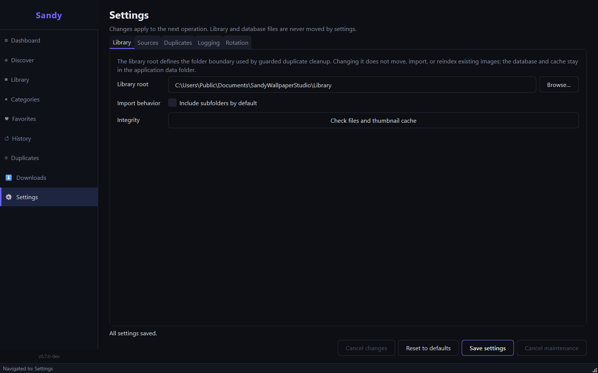
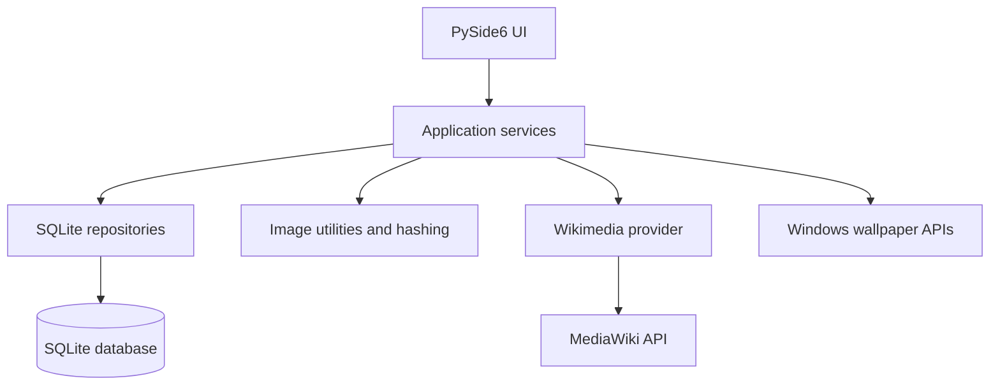

# Sandy Wallpaper Studio

> **Find it. Organize it. Make it your desktop.**
>
> A Windows desktop wallpaper manager built with Python and PySide6 — combining local collection management, image validation, perceptual duplicate detection, Wikimedia Commons metadata, and native desktop wallpaper controls.

<p align="center">
  <a href="./LICENSE"></a>
  <a href="https://github.com/Sandy32513/Sandy-Wallpaper-Studio/releases"></a>
  <a href="https://github.com/Sandy32513/Sandy-Wallpaper-Studio/actions/workflows/tests.yml"></a>
  <a href="https://github.com/Sandy32513/Sandy-Wallpaper-Studio"></a>
  <a href="https://www.python.org/"></a>
  <a href="https://www.qt.io/qt-for-python"></a>
</p>

<p align="center">
  <a href="#overview">Overview</a> ·
  <a href="#features">Features</a> ·
  <a href="#quick-start">Quick Start</a> ·
  <a href="#usage">Usage</a> ·
  <a href="#architecture">Architecture</a> ·
  <a href="#development">Development</a> ·
  <a href="#roadmap">Roadmap</a> ·
  <a href="#contributing">Contributing</a>
</p>

---

<!-- HERO IMAGE PLACEHOLDER
     Replace this comment block with a real screenshot once captured.
     Suggested capture: 1280×800 showing the Library or Dashboard view on Windows 11.
     Save as docs/assets/hero.png and uncomment the line below.


-->

> **Screenshot placeholder** — see [Needs human action](#needs-human-action) for capture instructions.

---

## Contents

- [Overview](#overview)
- [Project status](#project-status)
- [Features](#features)
- [Screenshots](#screenshots)
- [Technology stack](#technology-stack)
- [Quick start](#quick-start)
- [Packaging a Windows validation bundle](#packaging-a-windows-validation-bundle)
- [Usage](#usage)
- [Configuration and local data](#configuration-and-local-data)
- [Network, privacy, and content licensing](#network-privacy-and-content-licensing)
- [Architecture](#architecture)
- [Development](#development)
- [Roadmap](#roadmap)
- [Troubleshooting](#troubleshooting)
- [Contributing](#contributing)
- [Security](#security)
- [License and credits](#license-and-credits)

---

## Overview

Sandy Wallpaper Studio is a **local-first wallpaper manager for Windows 10 and 11**. It helps you build a searchable, deduplicated collection of high-resolution images from your existing folders, discover and download Creative Commons imagery from Wikimedia Commons, and apply selected wallpapers to the Windows desktop — all without cloud accounts or analytics.

The project pairs a PySide6 desktop interface with a Python service layer and SQLite persistence. It targets users who want a more organized desktop-image library, and developers interested in a modular Python desktop application.

### At a glance

| | Details |
|---|---|
| Target platform | Windows 10 / Windows 11; validation to date ran on Windows 11 |
| Python | 3.12 or later |
| Interface | PySide6 / Qt for Python |
| Local persistence | SQLite (WAL mode, foreign-key enforcement, schema migrations) |
| Online wallpaper source | Wikimedia Commons via the MediaWiki API (backend implemented; Discover/Downloads GUI screens are placeholders) |
| Version | `V1.0.0` |
| Windows build | Unsigned local validation bundle; no public download or installer |
| Latest implemented milestone | Phase 12 — isolated PyInstaller bundle validation (no public release) |

---

## Project status

Phases 0–10 are complete. Phase 11 release hardening is **partially complete**: the native Windows wallpaper API apply/restore test passed on Windows 11 on 2026-10-20, but physical keyboard/Narrator review, Windows 10 acceptance, and clean-machine acceptance remain open. The current version is `V1.0.0`. A matching unsigned Windows x64 `onedir` bundle was built and smoke-tested locally on Windows 11 from commit `725b7a9`; it is internal validation output only.

| Area | Status | Notes |
|---|---|---|
| Startup, configuration, logging | Complete | `python -m app` initialises the app and launches the GUI |
| SQLite library and categories | Complete | Migrations, repositories, search, statistics |
| Wikimedia Commons backend | Complete (backend) | Online search/download available via services; Discover/Downloads GUI screens are placeholders |
| Image validation and duplicate analysis | Complete | SHA-256 and pHash recomputed from current files during read-only scan |
| Local-folder import and library search | Complete | Library UI includes search/filter and import workflows |
| Native wallpaper setting and monitor detection | Complete (service layer) | Uses Windows APIs; per-monitor behaviour depends on display configuration |
| Desktop GUI — Dashboard, Library, Favorites, History | Complete | Core views implemented |
| Categories management screen | Complete | Dedicated Categories view implemented (Phase 13A) |
| Automatic wallpaper rotation | Complete | In-process Qt scheduling, configurable filters, pause/resume |
| Duplicate Manager | Complete | Exact/near review, side-by-side comparison, Windows Recycle Bin cleanup |
| Settings and attribution export | Complete | Preferences and CSV export |
| Release hardening | Partially complete | DNS pinning and native wallpaper API verified; physical-input/Narrator, Windows 10, clean-machine remain open |
| Windows packaging | Local validation passed | Unsigned `V1.0.0` onedir bundle smoke-tested; clean-machine/Windows 10 not yet run |
| Installer | Planned | Phase 13; no installer available |
| Discover screen | Placeholder | Backend exists; GUI not yet wired |
| Downloads screen | Placeholder | Backend exists; GUI not yet wired |

For full milestone evidence see [Project Status](docs/PROJECT_STATUS.md), [Phase 11 Acceptance](docs/PHASE11_ACCEPTANCE.md), [Packaging](docs/PACKAGING.md), and [Windows Manual Acceptance](docs/WINDOWS_ACCEPTANCE.md).

---

## Features

### Wallpaper library

- Import existing image folders using recursive or flat discovery.
- Index local files with dimensions, resolution labels, aspect ratio, format, and source metadata.
- Search and filter indexed wallpapers by title, category, resolution, aspect ratio, source, and license.
- Browse a paginated library and review collection statistics.
- Maintain categories (create, rename, delete) through a dedicated Categories view.

### Image intelligence

- Validate image formats and decode image content before indexing.
- Supported import formats: JPEG, PNG, WebP.
- Calculate SHA-256 hashes for exact duplicate matching.
- Use perceptual hashes (pHash, dHash, aHash) to identify visually similar images.
- Classify standard resolution tiers (FHD, QHD, 4K, 5K, 8K, Ultrawide) and aspect ratios.
- Generate and cache thumbnails.
- Run non-destructive library integrity checks for missing files and stale thumbnails.
- Enforce a 40-megapixel source-image ceiling before decode, hashing, or Qt previews; 8K UHD/DCI images (≤ 33 MP) remain fully supported.

### Duplicate Manager

- Scan the indexed library in the background; the scan is read-only and recomputes hashes from current files.
- Exact groups require matching SHA-256 plus byte-for-byte comparison.
- Near groups use a configurable 64-bit pHash Hamming-distance threshold (default ≤ 10).
- Search, sort, page through groups, and compare two to four candidates side by side.
- On Windows, select individual cleanup targets; each target is revalidated immediately before the operation.
- Cleanup sends files to the Windows Recycle Bin through `IFileOperation` with `FOFX_RECYCLEONDELETE`. There is no permanent-deletion fallback.
- Files outside the configured library, symbolic links, hard links, changed files, and locked files are rejected.

### Discover and download (backend only)

The provider layer integrates with the official Wikimedia Commons MediaWiki API:

- Text/category-assisted search with minimum-dimension filters.
- Image dimensions, download/source URLs, author, license name, and license URL when supplied.
- Streaming downloads with configurable size limit, content-type checks, retry/backoff, and cancellation.
- Temporary-file handling before a completed download is moved to its destination.

> **UI limitation:** the Discover and Downloads sidebar destinations are placeholders. The backend services exist; the GUI screens that wire them to the interface are not yet implemented.

### Desktop management

- Apply a selected wallpaper using the Windows `SystemParametersInfoW` API.
- Wallpaper styles: Center, Tile, Stretch, Fit, Fill, and Span.
- Monitor enumeration and display-bounds information.
- Random wallpaper selection with category, favorite, and minimum-resolution filters plus repeat avoidance.
- Previous-wallpaper restoration using history records.
- Preview rendering for each layout style.

### Favorites and history

- Add or remove wallpapers from Favorites.
- Filter favorites by category; sort by added date, title, resolution, or usage.
- Apply a random favorite with one click.
- Review desktop-applied history and reapply any entry.
- Restore the previous wallpaper.
- Browse recently viewed and recently downloaded/imported entries.

### Automatic rotation

- Configure interval (1 minute to 7 days), selection mode (random or library-order), category filter, and minimum dimensions in **Settings**.
- Rotation runs only while the application is open. It does not install a Windows service or scheduled task.
- Pause, Resume, and Stop controls available at runtime.
- Successful and failed rotation attempts appear in **History → Rotation Events**.

### Settings and attribution

- Configure library root, import behavior, Wikimedia access, download safeguards, duplicate threshold, thumbnail cache, and logging.
- Export stored creator, source, license, and image details to UTF-8 CSV with formula-injection protection and overwrite confirmation.
- All settings persist to a validated JSON file using atomic same-directory replacement.

See [Configuration](docs/CONFIGURATION.md) for the full schema, validation rules, and defaults.

---

## Screenshots

Settings captures were taken from a running Windows Qt application with synthetic data at 125% display scaling.



Additional captures: [1024×768](docs/images/phase10/settings-1024x768.png), [800×600](docs/images/phase10/settings-800x600.png), [1440×900](docs/images/phase10/settings-1440x900.png).

> **Library, Dashboard, Categories, Favorites, and History screenshots** — see [Needs human action](#needs-human-action).

---

## Technology stack

| Technology | Role |
|---|---|
| Python 3.12+ | Application language and runtime |
| PySide6 | Native desktop GUI (Qt for Python) |
| SQLite | Local metadata, categories, history, and repository persistence |
| Pillow | Image validation, resizing, and thumbnail/preview processing |
| ImageHash | Perceptual image hashes for similarity detection |
| Requests | HTTP/API communication and image downloads |
| Windows APIs via `ctypes` | Native wallpaper application and monitor enumeration |
| pytest | Automated test suite (21 test files, phases 0–12) |
| Ruff / mypy | Linting and static type checking |
| setuptools | Python packaging build backend |
| PyInstaller 6.22.3 | Unsigned Windows x64 onedir bundle (packaging extra) |

Runtime dependencies: [pyproject.toml](pyproject.toml), [requirements.txt](requirements.txt).

---

## Quick start

### Prerequisites

- Windows 10 or Windows 11.
- Python 3.12 (available via the Windows Python launcher: `py -3.12`).
- Git.

### 1. Clone

Open PowerShell:

```powershell
git clone https://github.com/Sandy32513/Sandy-Wallpaper-Studio.git
Set-Location Sandy-Wallpaper-Studio
```

### 2. Create environment and install

```powershell
py -3.12 -m venv .venv
.\.venv\Scripts\python.exe -m pip install --upgrade pip
.\.venv\Scripts\python.exe -m pip install -e ".[dev]"
```

### 3. Verify

```powershell
.\.venv\Scripts\python.exe -m app --version
.\.venv\Scripts\python.exe -m pytest
```

### 4. Run the application

```powershell
.\.venv\Scripts\python.exe -m app
```

The entry point initialises configuration and SQLite, then opens the PySide6 GUI. If GUI initialisation fails, the code falls back to a console status report for diagnostics.

The installed console script is also available:

```powershell
.\.venv\Scripts\sandy-wallpaper-studio.exe
```

### First-run data location

By default, application data lives at:

```text
%USERPROFILE%\Pictures\SandyWallpaperStudio
```

Override on startup:

```powershell
.\.venv\Scripts\python.exe -m app --library "D:\WallpaperStudioData"
```

---

## Packaging a Windows validation bundle

> There is no public download or installer. The procedure below produces an unsigned internal validation bundle only.

On Windows x64 with Python 3.12:

```powershell
py -3.12 -m venv .venv
.\.venv\Scripts\python.exe -m pip install -e ".[dev,packaging]"
.\scripts\build_windows.ps1
```

The script runs Ruff, mypy, and pytest; builds the onedir bundle; verifies version resources; and performs an isolated GUI smoke test. Output goes to `build\phase 12\dist\SandyWallpaperStudio\`.

Launch the bundle:

```powershell
& ".\build\phase 12\dist\SandyWallpaperStudio\SandyWallpaperStudio.exe"
```

Keep the EXE beside its `_internal` directory. The bundle is unsigned, has not been tested on Windows 10 or a clean machine, and is not a public release. See [Packaging](docs/PACKAGING.md) for the full contract.

---

## Usage

The instructions below reflect views and controls present in the current source.

### Dashboard and Library

1. Run `.\\.venv\Scripts\python.exe -m app`.
2. **Dashboard** shows library statistics and monitor information.
3. Open **Library** to browse indexed wallpapers.
4. Use the search/filter toolbar to narrow results by title, category, resolution, or aspect ratio.
5. Use the import workflow (**Import Folder**) to select an existing folder and track its progress.

### Inspect an image

Open a wallpaper card's detail view to inspect metadata and use available actions (apply, favorite, export). Inspecting a wallpaper adds it to **Recently Viewed** history.

### Categories

Open **Categories** in the sidebar to create, rename, or delete categories. Category names are free text; deleting a category does not delete any wallpaper files or database records.

### Favorites

1. Add or remove a wallpaper using the star control on any card.
2. Open **Favorites** to view saved wallpapers, filter by category, and sort.
3. Use **Random Favorite** to apply a random saved wallpaper.
4. **Clear Favorites** removes favorite status only; it does not delete image files.

### Apply and restore a wallpaper

Use a wallpaper card or detail dialog to apply a wallpaper. Open **History** to review the applied timeline and reapply or restore entries.

### History

- **Desktop Applied** — chronological log with thumbnails, timestamps, and a reapply button.
- **Recently Viewed** — wallpapers you have inspected in the current session.
- **Recently Downloaded / Imported** — recently added wallpapers ordered by import date.

### Automatic rotation

1. Open **Settings** and configure the rotation interval, selection mode, category, and minimum resolution.
2. Click **Apply Settings** to enable.
3. Use **Pause**, **Resume**, and **Stop** from the sidebar or Settings to control the schedule.

### Duplicate Manager

1. Open **Duplicates** in the sidebar to start a background scan.
2. Review exact and near-match groups; select files to keep and files to remove.
3. On Windows, confirm targets in the cleanup dialog; each file is revalidated before it is sent to the Recycle Bin.

### Not yet available

- Searching or browsing Wikimedia Commons from the **Discover** screen.
- Initiating downloads from the **Downloads** screen.

---

## Configuration and local data

Settings are stored as JSON at `settings.json` in the application data root. Writes use atomic same-directory replacement. Invalid settings are rejected individually; valid values in the same file survive.

| Data | Default location |
|---|---|
| Application data root | `%USERPROFILE%\Pictures\SandyWallpaperStudio` |
| Settings | `settings.json` in the data root |
| SQLite database | `wallpapers.db` in the data root |
| Library | `Library` (configurable existing folder) |
| Thumbnail cache | `Cache\thumbnails` |
| Temporary files | `Temp` |
| Logs | `Logs\app.log` |
| Attribution exports | `Exports` |

The `--library` argument at startup changes the application data root. Changing the library-root setting in the UI does not move images, reindex database rows, or change the database path — it updates the safety boundary used by the Duplicate Manager cleanup.

### Download and security safeguards

- Downloads check response metadata and stream size against a configurable limit (default 100 MB).
- HTTP status, content type, image format, and decode integrity are verified before a completed download is published.
- Source images above 40,000,000 pixels are rejected before decode.
- Downloads require direct HTTPS on port 443, reject credentials and redirects, check DNS for non-global answers, and disable proxies.
- Settings values are validated individually and saved atomically.
- Attribution CSV export is atomic, escapes formula-like cells, and confirms before overwriting an existing file.
- Duplicate cleanup revalidates each target immediately before the Recycle Bin operation.

See [Configuration](docs/CONFIGURATION.md) for all defaults, ranges, and service behavior documentation.

---

## Network, privacy, and content licensing

The current online wallpaper source is Wikimedia Commons, accessed through the official MediaWiki API. The codebase does not implement user accounts, cloud library storage, analytics, or advertising telemetry. Read [PRIVACY.md](PRIVACY.md) for the project's privacy statement.

Wikimedia Commons items can carry different licenses and attribution requirements. The application records available author, source URL, license name, and license URL metadata when supplied by the provider. Before redistributing or reusing a downloaded image, open its source page and comply with the license and any attribution or share-alike terms.

**The MIT license covers the project code only — not any wallpaper downloaded through it.**

---

## Architecture

Sandy Wallpaper Studio separates presentation, application services, data access, providers, and image utilities into strict unidirectional layers. Presentation never queries the database directly; all interaction flows through domain services.

### Project structure

```text
app/
├── __main__.py                     # python -m app entry point
├── main.py                         # CLI arguments, startup, GUI launch/fallback
├── config.py                       # Validated JSON settings, app-data paths
├── constants.py                    # Formats, resolution classes, defaults
├── database/
│   ├── database.py                 # SQLite connection, WAL, foreign keys, migrations
│   ├── migrations.py               # Ordered migration sequence
│   ├── models.py                   # Domain dataclasses
│   ├── wallpaper_repository.py     # Wallpaper CRUD, search, pagination
│   ├── category_repository.py      # Category management
│   ├── history_repository.py       # Desktop-applied history
│   └── view_repository.py          # Recently-inspected records
├── sources/
│   ├── base.py                     # WallpaperSource abstract base class
│   └── wikimedia.py                # Wikimedia Commons / MediaWiki API provider
├── services/
│   ├── source_service.py           # Provider coordination
│   ├── download_service.py         # Streaming downloads and validation
│   ├── metadata_service.py         # Image/metadata extraction
│   ├── import_service.py           # Local folder import pipeline
│   ├── library_service.py          # Library queries, stats, integrity checks
│   ├── wallpaper_service.py        # Windows wallpaper API and previews
│   ├── history_service.py          # Favorites and history orchestration
│   ├── category_service.py         # Category business logic
│   ├── duplicate_service.py        # Hash-based duplicate analysis
│   ├── duplicate_scan_service.py   # Background scan coordination
│   ├── duplicate_scan_worker.py    # QThread-based scanner
│   ├── duplicate_cleanup_service.py# Recycle Bin cleanup with revalidation
│   ├── rotation_service.py         # Rotation selection logic
│   ├── rotation_scheduler.py       # In-process Qt rotation timer
│   └── attribution_export_service.py # Attribution CSV export
├── ui/
│   ├── main_window.py              # Root window, sidebar, view stack, status bar
│   ├── design_system.py            # Obsidian dark theme, typography, spacing tokens
│   ├── dashboard_view.py           # Dashboard statistics and quick actions
│   ├── library_view.py             # Library grid, search, import
│   ├── categories_view.py          # Categories management screen
│   ├── favorites_view.py           # Favorites showcase with sorting
│   ├── history_view.py             # Desktop-applied, recently viewed, recently added
│   ├── rotation_view.py            # Rotation configuration and schedule controls
│   ├── duplicate_manager_view.py   # Exact/near review and guarded cleanup
│   ├── settings_view.py            # All preferences tabs
│   └── components/
│       ├── sidebar.py              # Animated navigation sidebar
│       ├── search_bar.py           # Debounced search and filter toolbar
│       ├── wallpaper_card.py       # Async thumbnail card widget
│       ├── detail_dialog.py        # High-resolution preview and metadata dialog
│       ├── import_dialog.py        # Import progress dialog
│       ├── comparison_dialog.py    # Side-by-side duplicate comparison
│       └── cleanup_confirmation_dialog.py  # Recycle Bin cleanup confirmation
└── utils/
    ├── hashing.py                  # SHA-256 and perceptual hash helpers
    ├── image_utils.py              # Validation, decode, resolution helpers
    ├── filename.py                 # Windows-safe filename sanitisation
    └── logging_config.py           # Rotating file and console logging

tests/                              # 21 test files, phases 0–12
docs/
├── ARCHITECTURE.md                 # Layer diagrams and component detail
├── CONFIGURATION.md                # Settings schema, defaults, validation rules
├── DEVELOPMENT.md                  # Developer setup and workflow guide
├── PACKAGING.md                    # Windows PyInstaller packaging procedures
├── ROADMAP.md                      # Phase deliverables and status
├── PROJECT_STATUS.md               # Detailed milestone evidence
├── PHASE11_ACCEPTANCE.md           # Release-hardening acceptance matrix
├── PHASE11_PERFORMANCE.md          # Synthetic scan benchmark results
└── WINDOWS_ACCEPTANCE.md           # Manual acceptance procedures and gates
packaging/
└── SandyWallpaperStudio.spec       # PyInstaller spec file
scripts/
├── build_windows.ps1               # Reproducible build and smoke test
├── validate_packaged_windows.ps1   # Post-build validation
├── phase11_benchmark.py            # Synthetic duplicate-scan benchmark
└── manual_wallpaper_acceptance.py  # Manual wallpaper API acceptance helper
```

### Data flow



The diagram is a logical overview. Not every service workflow is reachable from a completed GUI screen.

---

## Development

### Run the full quality gate

```powershell
.\.venv\Scripts\python.exe -m ruff check app tests scripts
.\.venv\Scripts\python.exe -m mypy app
.\.venv\Scripts\python.exe -m pytest -v
```

### Run a specific phase suite

```powershell
.\.venv\Scripts\python.exe -m pytest tests/test_phase7.py -v
.\.venv\Scripts\python.exe -m pytest tests/test_phase9.py tests/test_phase9_cleanup.py tests/test_phase9_workflow.py -v
.\.venv\Scripts\python.exe -m pytest tests/test_phase10.py -v
.\.venv\Scripts\python.exe -m pytest tests/test_phase11.py tests/test_phase11_ui.py -v
```

### Run tests in headless mode (CI simulation)

```powershell
$env:QT_QPA_PLATFORM = "offscreen"
.\.venv\Scripts\python.exe -m pytest -v
Remove-Item Env:QT_QPA_PLATFORM
```

### Run Windows-rendered UI captures

```powershell
$env:QT_QPA_PLATFORM = "windows"
.\.venv\Scripts\python.exe -m pytest tests/test_phase11_ui.py -q -s
Remove-Item Env:QT_QPA_PLATFORM
```

### Run the synthetic duplicate-scan benchmark

```powershell
.\.venv\Scripts\python.exe scripts/phase11_benchmark.py --sizes 100 500 1000 5000
```

### Build the Windows validation bundle

```powershell
.\.venv\Scripts\python.exe -m pip install -e ".[dev,packaging]"
.\scripts\build_windows.ps1
```

### CI

The [GitHub Actions workflow](.github/workflows/tests.yml) runs on `windows-latest` with Python 3.12. It installs `.[dev]`, verifies both entry points, runs Ruff, mypy, and the full pytest suite (offscreen Qt), then builds and smoke-tests the internal bundle in a dependent job. No artifact is uploaded. Review results in [GitHub Actions](https://github.com/Sandy32513/Sandy-Wallpaper-Studio/actions/workflows/tests.yml).

For more detail, see [Development Guide](docs/DEVELOPMENT.md), [Architecture](docs/ARCHITECTURE.md), and [Packaging](docs/PACKAGING.md).

---

## Roadmap

| Phase | Scope | Status |
|---|---|---|
| 0 | Foundation, startup, configuration, logging | Complete |
| 1 | SQLite models, migrations, repositories, categories | Complete |
| 2 | Wikimedia source integration and download service | Complete (backend) |
| 3 | Image validation, hashing, duplicate detection, thumbnails | Complete (backend) |
| 4 | Local import, search, filters, statistics, integrity checks | Complete |
| 5 | Windows wallpaper engine, styles, monitor detection, restore | Complete (service layer) |
| 6 | PySide6 desktop interface | Complete |
| 7 | Favorites and history workflows | Complete |
| 8 | Automatic wallpaper rotation | Complete |
| 9 | Duplicate Manager UI | Complete |
| 10 | Settings, attribution export, operational features | Complete |
| 11 | QA, compatibility, and release hardening | Partially complete — physical-input/Narrator, Windows 10, clean-machine remain open |
| 12 | PyInstaller packaging | Local onedir bundle validated on Windows 11; clean-machine/Windows 10 not yet run |
| 13 | Windows installer | Planned |

Planned improvements (tracked gaps from this audit):

- [ ] Build the Windows installer (NSIS/WiX or Inno Setup) with per-user install, upgrade path, and safe uninstall
- [ ] Wire the Discover screen to the Wikimedia Commons backend
- [ ] Wire the Downloads screen to the DownloadService queue
- [ ] Complete Windows 10 and clean-machine acceptance testing
- [ ] Obtain code signing certificate and sign the installer and bundle
- [ ] Add a GitHub release with signed installer and checksums
- [ ] Capture and commit hero/dashboard/library/categories screenshots to docs/

See [docs/ROADMAP.md](docs/ROADMAP.md) and [docs/PROJECT_STATUS.md](docs/PROJECT_STATUS.md) for milestone evidence.

---

## Troubleshooting

### Python version is unsupported

```powershell
py -3.12 --version
```

Requires Python 3.12 or later. If the launcher cannot find it, install Python 3.12 and enable the launcher during setup.

### PowerShell blocks virtual-environment activation

Invoke the environment interpreter directly without activating:

```powershell
.\.venv\Scripts\python.exe -m pip install -e ".[dev]"
.\.venv\Scripts\python.exe -m app
```

### Missing dependencies or pytest not found

```powershell
.\.venv\Scripts\python.exe -m pip install -e ".[dev]"
```

For runtime dependencies only (no tests):

```powershell
.\.venv\Scripts\python.exe -m pip install -r requirements.txt
```

### Qt GUI does not open

Run with `--debug` and inspect the log:

```powershell
.\.venv\Scripts\python.exe -m app --debug
```

Log location: `%USERPROFILE%\Pictures\SandyWallpaperStudio\Logs\app.log`

Check that PySide6 is installed in the same environment used to run the application.

### Wikimedia search or downloads fail

Check network connectivity to Wikimedia Commons and retry later if the API or file server is unavailable. HTTP errors, rate limits, timeouts, and failed downloads are logged. An empty search result alone does not confirm that no matching image exists.

### A local image cannot be imported

Confirm the file is readable and its contents are a valid image (not just a file with an image extension). Check the import log for the file-level error. Supported formats are JPEG, PNG, and WebP.

### Wallpaper was not applied or monitor details look wrong

Native application depends on Windows APIs. Confirm the image path is accessible and that Windows display settings are as expected. Multi-monitor layout may affect which monitor receives the wallpaper.

### Database or library issue

Close the application cleanly and back up the app data root before attempting recovery. Run a non-destructive library integrity check from the UI. Do not delete the SQLite database, WAL files, library images, or configuration as a first-line fix.

---

## Contributing

Contributions are welcome — focused bug reports, reproducible test cases, UI accessibility improvements, and documentation fixes.

1. Search [existing issues](https://github.com/Sandy32513/Sandy-Wallpaper-Studio/issues) before opening a new one.
2. Include your Windows version, Python version, exact reproduction steps, expected and actual behavior, and sanitised log excerpts.
3. Create a focused branch; keep pull requests limited to one concern.
4. Add or update tests when behavior changes; run the quality gate before opening a PR.
5. Update documentation when commands, configuration, workflows, or supported behavior change.

See [CONTRIBUTING.md](CONTRIBUTING.md) for setup, coding guidelines, and the PR checklist.
Do not attach private wallpaper collections, credentials, or logs containing personal file paths.

---

## Security

Do not open a public GitHub issue for a security vulnerability. See [SECURITY.md](SECURITY.md) for the responsible disclosure process.

---

## Needs human action

The following items require a human on a real Windows machine:

| Item | Instructions |
|---|---|
| Hero screenshot | Run the app at 1280×800, take a screenshot of the Dashboard or Library view, save as `docs/assets/hero.png`, and update the `![…]` reference in README |
| Library / Dashboard / Categories / Favorites screenshots | Capture at 1280×800 and 1440×900, save under `docs/images/`, and add to the Screenshots section |
| Windows 10 acceptance | Follow [docs/WINDOWS_ACCEPTANCE.md](docs/WINDOWS_ACCEPTANCE.md) on a Windows 10 machine |
| Clean-machine install test | Fresh VM or machine — follow the Quick Start section end-to-end |
| Physical keyboard / Narrator review | Follow [docs/WINDOWS_ACCEPTANCE.md](docs/WINDOWS_ACCEPTANCE.md) |
| License confirmation | Owner should confirm MIT license applies to the project code |
| GitHub repo settings | Set description, topics (python, pyside6, wallpaper, windows, desktop), and social preview image |
| Branch protection | Enable required reviews and status checks on `main` |

---

## License and credits

The project code is distributed under the [MIT License](LICENSE). Copyright © 2026 Sandy.

Sandy Wallpaper Studio uses Python, PySide6, Pillow, ImageHash, Requests, and SQLite. See [pyproject.toml](pyproject.toml) for version constraints and upstream license details.

Wallpaper files are third-party content. Their individual licenses may differ from the project license. Preserve available author, source, and license details, and check the source page before reusing or redistributing any image.

---

## Project links

- **Repository:** [Sandy32513/Sandy-Wallpaper-Studio](https://github.com/Sandy32513/Sandy-Wallpaper-Studio)
- **Issues:** [GitHub Issues](https://github.com/Sandy32513/Sandy-Wallpaper-Studio/issues)
- **Project status:** [docs/PROJECT_STATUS.md](docs/PROJECT_STATUS.md)
- **Roadmap:** [docs/ROADMAP.md](docs/ROADMAP.md)
- **Architecture:** [docs/ARCHITECTURE.md](docs/ARCHITECTURE.md)
- **Development guide:** [docs/DEVELOPMENT.md](docs/DEVELOPMENT.md)
- **Configuration:** [docs/CONFIGURATION.md](docs/CONFIGURATION.md)
- **Packaging:** [docs/PACKAGING.md](docs/PACKAGING.md)
- **Windows acceptance:** [docs/WINDOWS_ACCEPTANCE.md](docs/WINDOWS_ACCEPTANCE.md)
- **Contributing:** [CONTRIBUTING.md](CONTRIBUTING.md)
- **Code of Conduct:** [CODE_OF_CONDUCT.md](CODE_OF_CONDUCT.md)
- **Security:** [SECURITY.md](SECURITY.md)
- **Changelog:** [CHANGELOG.md](CHANGELOG.md)
- **Privacy:** [PRIVACY.md](PRIVACY.md)
- **License:** [LICENSE](LICENSE)

---

*Built by Sandy / [@Sandy32513](https://github.com/Sandy32513).*
