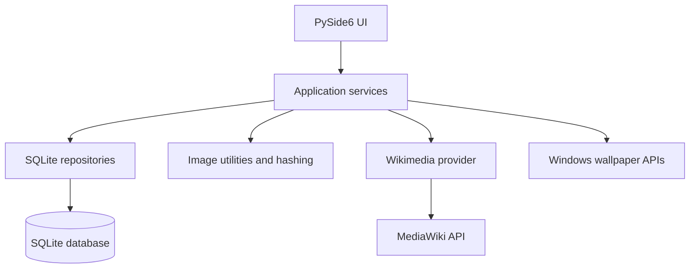

# Sandy Wallpaper Studio

> **Find it. Organize it. Make it your desktop.**
>
> A Windows desktop wallpaper library built with Python and PySide6, combining local collection management, image validation, duplicate detection, Wikimedia Commons metadata, and native desktop wallpaper controls.

<p align="center">
  <a href="https://github.com/Sandy32513/Sandy-Wallpaper-Studio"></a>
  <a href="https://www.python.org/"></a>
  <a href="https://www.qt.io/qt-for-python"></a>
  <a href="./LICENSE"></a>
  <a href="./docs/PROJECT_STATUS.md"></a>
</p>

<p align="center">
  <a href="#overview">Overview</a> ·
  <a href="#features">Features</a> ·
  <a href="#quick-start">Quick start</a> ·
  <a href="#using-the-application">Usage</a> ·
  <a href="#architecture">Architecture</a> ·
  <a href="#testing">Testing</a> ·
  <a href="#roadmap">Roadmap</a> ·
  <a href="#contributing">Contributing</a>
</p>

---

## Contents

- [Overview](#overview)
- [Project status](#project-status)
- [Features](#features)
- [Technology stack](#technology-stack)
- [Screenshots](#screenshots)
- [Quick start](#quick-start)
- [Using the application](#using-the-application)
- [Architecture](#architecture)
- [Configuration and local data](#configuration-and-local-data)
- [Network, privacy, and licensing](#network-privacy-and-licensing)
- [Testing](#testing)
- [Roadmap](#roadmap)
- [Troubleshooting](#troubleshooting)
- [Contributing](#contributing)
- [License and credits](#license-and-credits)

## Overview

Sandy Wallpaper Studio is a **local-first wallpaper manager for Windows 10 and Windows 11**. It is designed to help users build a searchable collection of high-resolution images, bring existing folders into one library, identify duplicate or visually similar images, and apply selected wallpapers to the Windows desktop.

The project pairs a PySide6 desktop interface with a Python service layer and SQLite persistence. Wikimedia Commons is the implemented online source; the application captures available source and licensing metadata alongside image details.

It is aimed at Windows users who want a more organized desktop-image library and developers interested in a modular Python desktop application.

### At a glance

| | Details |
|---|---|
| Platform | Windows 10 / Windows 11 |
| Python | 3.12 or later |
| Interface | PySide6 / Qt for Python |
| Local persistence | SQLite |
| Online wallpaper source | Wikimedia Commons via the MediaWiki API |
| Project maturity | Development build; not a packaged release |
| Latest implemented milestone | Phase 10 - Settings & Operational Features (complete) |
| Latest test result | See the current test and QA record in [Project Status](docs/PROJECT_STATUS.md) |

## Project status

Phases 0-10 are complete. Phase 10 adds validated settings, operational controls wired to their services, background thumbnail maintenance, a library integrity check, and safe CSV attribution export. See [Project Status](docs/PROJECT_STATUS.md) for the completion matrix and current QA evidence. Discover, Categories, and Downloads remain placeholder destinations.

| Area | Current status | Notes |
|---|---|---|
| Startup, configuration, logging | Implemented | `python -m app` initializes the app and attempts to launch the GUI |
| SQLite library and categories | Implemented | Database migrations, repositories, search and statistics |
| Wikimedia Commons search metadata and downloads | Implemented in backend | Online search/download is available through services; the GUI Discover/Downloads destinations are placeholders |
| Image validation and duplicate analysis | Implemented | SHA-256 and pHash are recomputed from current files during a read-only scan |
| Local-folder import and library search | Implemented | Library UI includes search/filter and import workflows |
| Native wallpaper setting and monitor detection | Implemented in service layer | Uses Windows APIs; monitor behavior depends on Windows and display setup |
| Desktop GUI | Implemented | Dashboard, Library, Favorites and History views are present |
| Favorites and history | Implemented | Includes applied, viewed, and recently added/imported history workflows |
| Automatic wallpaper rotation | Complete | In-process Qt scheduling, configurable filters, pause/resume and rotation event history |
| Duplicate Manager | Complete | Exact/near review, comparison, revalidated cleanup preview, and explicit Windows Recycle Bin workflow |
| Settings and attribution export | Complete | Operational preferences and stored-metadata CSV export |
| Release hardening and packaging | Planned | Phases 11–13; no installer is claimed to be available |

For detailed milestone acceptance notes, see [Project Status](docs/PROJECT_STATUS.md) and [Roadmap](docs/ROADMAP.md). Historical test counts in those documents are not a guarantee of the current machine's result.

## Features

### Wallpaper library

- Import existing image folders using recursive or flat discovery.
- Index local files with image metadata, dimensions, resolution labels and aspect ratio.
- Search and filter indexed wallpapers using available metadata, including title, category, resolution, aspect ratio, source and license.
- Browse a paginated library and review collection statistics.
- Maintain categories using the database/repository layer. A dedicated Categories UI is not yet implemented.

### Image intelligence

- Validate image formats and decode image content before indexing.
- Recognize supported formats in the current import/processing paths, including JPEG, PNG and WebP; additional format support should be confirmed against the relevant processing path before relying on it.
- Calculate SHA-256 hashes for exact duplicate matching.
- Use perceptual hashes (pHash, dHash and aHash) to identify potentially similar images.
- Classify common resolution tiers and aspect ratios.
- Generate and cache thumbnails.
- Run non-destructive library integrity checks for missing files and stale thumbnails.

### Duplicate Manager

- Scan the indexed library in the background. The scan reads the database in read-only mode and recomputes hashes from current files.
- Exact groups require matching SHA-256 and a byte-for-byte comparison. Their redundant-byte estimate counts exact copies only.
- Near groups use a configurable inclusive 64-bit pHash Hamming-distance threshold. The displayed percentage is `(64 - distance) / 64 × 100`; it is a direct image-hash comparison, not a probability or proof that two images are interchangeable. Connected groups can contain chains, and each displayed score describes a direct pair.
- Search and sort groups, page through large groups, choose a retained file, and compare two to four candidates side by side.
- On Windows, select individual cleanup targets and review their full paths, sizes, retained files, count, estimate, and method in a confirmation dialog. Each target and retained file is revalidated immediately before the operation.
- Cleanup requests the Windows Recycle Bin through `IFileOperation` with `FOFX_RECYCLEONDELETE`. There is no permanent-delete fallback. A failure stops the remaining targets and reports each file outcome.
- Cleanup is unavailable on non-Windows systems. Files outside the configured library, symbolic links/reparse points, hard-linked files, changed files, and files that cannot be opened exclusively are rejected.
- The SQLite wallpaper, favorites, history, and view rows remain in place after a file is recycled. A later scan reports a missing path until the item is restored or reimported.

### Discover and download

The provider layer integrates with the official Wikimedia Commons MediaWiki API and supports:

- Text/category-assisted source search and minimum-dimension filters.
- Image dimensions, download/source URLs, author, license name and license URL when supplied by the provider.
- Streaming downloads with a configurable size limit, content-type checks, retry/backoff and cancellation hooks.
- Temporary-file handling before a completed download is moved to its destination.
- Filename sanitization and prevention of silent overwrites.

**UI limitation:** the current sidebar's Discover, Downloads and Categories destinations are placeholders. The provider and download services exist in the codebase, but those destinations should not be mistaken for completed browse/download screens.

### Desktop management

The Windows wallpaper service includes:

- Applying a selected wallpaper using the Windows `SystemParametersInfoW` API.
- Wallpaper styles: `Center`, `Tile`, `Stretch`, `Fit`, `Fill` and `Span`.
- Monitor enumeration and display bounds information.
- Random wallpaper selection with supported category, favorite and minimum-resolution filters, plus repeat avoidance.
- Previous-wallpaper restoration using history records.
- Preview rendering for the supported layout styles.

Multi-monitor detection is implemented; do not assume independent per-monitor wallpaper assignment unless that is explicitly verified for your Windows/display configuration.

### Favorites and history

- Add or remove wallpapers from Favorites.
- Filter favorites by category and sort by added date, title, resolution or usage.
- Apply a random favorite.
- Review desktop-applied history and reapply an entry.
- Restore the previous wallpaper.
- Browse recently viewed and recently downloaded/imported wallpaper entries.

The clear-favorites action removes favorite status; it does not delete image files.

### Automatic rotation

- Open **Settings** in the sidebar to configure local wallpaper rotation.
- Choose an interval from 1 minute to 7 days, random selection or library-order cycling, optional categories, and minimum width/height.
- Choose **Apply Settings** to enable or disable the schedule. The first wallpaper change occurs after one full interval; application startup never applies a wallpaper immediately.
- Use **Pause**, **Resume**, and **Stop** to control the in-process schedule. Pause is runtime-only; an enabled schedule resumes after a full interval when the application starts again.
- Rotation considers only indexed local library items and validates image files before applying them. Category and minimum-resolution filters remain strict; an empty match reports a status instead of relaxing the filters.
- Automatic success and failed application attempts appear in **History → Rotation Events**. Successful applications also appear in **Desktop Applied** with their source identified.

Rotation runs only while the application is open. It does not install a Windows service or scheduled task, access online sources, move files, or delete files.

### Settings and attribution

- Change the configured library cleanup boundary and default recursive import behavior. Existing files and the database are not moved or reindexed.
- Enable Wikimedia Commons and adjust request limits, minimum resolution, and timeout.
- Set download folder, image-size limit, request timeout, retry count/backoff, and concurrent-operation limit.
- Tune the 64-bit pHash Hamming-distance threshold (0–64). Exact matches continue to require SHA-256 plus byte comparison.
- Configure thumbnail dimensions, quality, cache enablement, and budget. Cache rebuild runs in the background and can be cancelled.
- Configure log level, file output, rotation size, and retention. Console logging remains available if file output fails.
- Export stored creator, source, license, and image details to UTF-8 CSV with formula-injection protection and overwrite confirmation.
- Select the saved desktop wallpaper style and continue to manage automatic local rotation.

See [Configuration](docs/CONFIGURATION.md) for the setting schema, validation rules, defaults, and application behavior.

## Technology stack

| Technology | Role |
|---|---|
| Python 3.12+ | Application language and runtime |
| PySide6 | Native desktop GUI using Qt for Python |
| SQLite | Local metadata, categories, history and repository persistence |
| Pillow | Image opening, validation support, resizing and preview/thumbnail processing |
| ImageHash | Perceptual image hashes used for similarity checks |
| Requests | HTTP/API communication and image downloads |
| Windows APIs via `ctypes` | Native wallpaper application and monitor enumeration |
| pytest | Automated test suite |
| Ruff / mypy / pytest-cov | Configured development tools in `pyproject.toml`; run separately when installed |
| setuptools | Python packaging/build backend configuration |

Runtime dependencies are declared in [pyproject.toml](pyproject.toml) and [requirements.txt](requirements.txt). The `dev` optional-dependency group is defined in `pyproject.toml`; this project does not currently include a separate `requirements-dev.txt` file.

## Screenshots

Settings captures from the running Windows Qt application use synthetic data. Requested logical window sizes were 1280x800, 1024x768, 800x600, and 1440x900. Windows display scaling rendered the saved PNGs at 125% physical dimensions. The compact 800x600 view keeps the settings controls and action row visible; longer pages scroll within their tab.


Additional inspected captures: [1024x768](docs/images/phase10/settings-1024x768.png), [800x600](docs/images/phase10/settings-800x600.png), and [1440x900](docs/images/phase10/settings-1440x900.png).

## Quick start

### Prerequisites

- Windows 10 or Windows 11.
- Python 3.12 or later available as `python`.
- Git.
- Internet access for Wikimedia Commons search and downloads.
- Sufficient disk space for images and the local library.

### 1. Clone the repository

Open PowerShell:

```powershell
git clone https://github.com/Sandy32513/Sandy-Wallpaper-Studio.git
Set-Location Sandy-Wallpaper-Studio
```

### 2. Create and activate a virtual environment

```powershell
python -m venv .venv
.\.venv\Scripts\Activate.ps1
```

If PowerShell blocks activation, see [Troubleshooting](#troubleshooting). You can also use the environment's Python executable directly without activating it.

### 3. Install the project

Recommended development checkout installation:

```powershell
python -m pip install --upgrade pip
python -m pip install -e ".[dev]"
```

This installs the package and the optional development tools declared by `pyproject.toml`, including pytest. Alternatively, to install only the runtime dependencies without editable packaging:

```powershell
python -m pip install -r requirements.txt
```

### 4. Launch the desktop application

```powershell
python -m app
```

The entry point initializes configuration and SQLite, then attempts to open the PySide6 GUI. If GUI initialization fails, the code falls back to a console status report. This fallback is a diagnostic/startup path, not a substitute for the desktop interface.

The project also declares a console script for installed environments:

```powershell
sandy-wallpaper-studio
```

If the command is not recognized, confirm that the virtual environment is active or invoke `python -m app` from the repository root.

### First-run data location

By default, application data is rooted at:

```text
%USERPROFILE%\Pictures\SandyWallpaperStudio
```

The exact folder names and paths are managed in the application configuration. You can override the library/configuration root on startup:

```powershell
python -m app --library "D:\WallpaperStudioData"
```

The `--library` option changes the application's data root; make sure the selected directory is writable and backed up if it contains important files.

## Using the application

The instructions below reflect views and controls found in the current source. Online discovery/download GUI screens and several other sidebar destinations remain placeholders.

### Dashboard and library

1. Run `python -m app`.
2. The Dashboard presents library statistics and monitor information.
3. Open **Library** to browse indexed wallpapers.
4. Use the library search/filter controls to narrow results with available metadata filters.
5. Use the import workflow to select an existing folder and follow its progress/completion report.

### Inspect an image

Open a wallpaper card's detail view to inspect available metadata and use the actions exposed by that dialog. Inspecting a wallpaper contributes to the Recently Viewed history workflow.

### Favorites

1. In Library, use the wallpaper card's favorite control to add or remove it.
2. Open **Favorites** to view saved wallpapers.
3. Filter by category or select a sort order.
4. Use **Random Favorite** to apply a random saved wallpaper.
5. **Clear Favorites** asks for confirmation and removes favorite status, not the image files.

### Apply and restore a wallpaper

Use a wallpaper card/detail action to apply a selected wallpaper. Applying a wallpaper is an operating-system action and may be affected by Windows settings or restrictions. Open **History** to inspect the applied timeline and use the available reapply/restore actions.

### History

The History view has separate workflows for desktop-applied entries, recently viewed wallpapers, and recently downloaded/imported wallpapers. Use the available details or reapply actions to revisit an entry.

### Not available as complete UI workflows yet

- Searching/browsing Wikimedia Commons from the Discover screen.
- Triggering downloads from the Downloads screen.
- Dedicated Categories management screen.
- Discover and Downloads remain placeholders; Settings configures the backend services but does not add source browsing or download initiation screens.

Backend capabilities do not imply that each workflow is wired into a finished GUI.

## Architecture

The project separates presentation, application services, data access, providers, and shared image utilities. Phase 10 adds validated JSON settings, `SettingsView`, safe attribution CSV export, configurable source/download construction, and background library/cache maintenance. Rotation and duplicate review remain dedicated service/UI workflows.

```text
app/
├── __main__.py                 # python -m app entry point
├── main.py                     # Startup, CLI arguments, GUI launch/fallback
├── config.py                   # JSON settings and app-data directories
├── constants.py                # Shared formats, styles, defaults
├── database/
│   ├── database.py             # SQLite connection, WAL, foreign keys, migrations
│   ├── migrations.py           # Schema migration sequence
│   ├── models.py               # Domain/data models
│   ├── wallpaper_repository.py # Wallpaper persistence and queries
│   ├── category_repository.py  # Category persistence
│   ├── history_repository.py   # Applied wallpaper history
│   └── view_repository.py      # Recently-viewed records
├── sources/
│   ├── base.py                 # Source contract and result model
│   └── wikimedia.py            # Wikimedia Commons MediaWiki API provider
├── services/
│   ├── source_service.py       # Source coordination
│   ├── download_service.py     # Streaming downloads and validation
│   ├── metadata_service.py     # Image/metadata extraction
│   ├── duplicate_service.py    # Hash-based duplicate analysis
│   ├── import_service.py       # Existing-folder import pipeline
│   ├── library_service.py      # Library queries, stats and integrity checks
│   ├── wallpaper_service.py    # Windows wallpaper operations and previews
│   └── history_service.py      # Favorites and history business logic
├── ui/
│   ├── main_window.py          # Main window, navigation and view wiring
│   ├── dashboard_view.py       # Dashboard
│   ├── library_view.py         # Library grid/search/import
│   ├── favorites_view.py       # Favorites view
│   ├── history_view.py         # History view
│   └── components/             # Sidebar, cards, search and dialogs
└── utils/
    ├── hashing.py              # SHA-256 and perceptual hashing helpers
    ├── image_utils.py          # Image validation and resolution helpers
    ├── filename.py             # Filename sanitization
    └── logging_config.py       # Logging configuration

tests/                          # Phase-based automated tests
docs/
├── PROJECT_STATUS.md           # Phase status and exit-gate notes
└── ROADMAP.md                  # Planned phase deliverables
```

### Request and data flow



The diagram is a logical overview: not every provider/service workflow is currently reachable from a dedicated GUI screen.

## Configuration and local data

Settings are stored as JSON at `settings.json` in the application data root. Writes use a same-directory temporary file and atomic replacement. Invalid settings are rejected individually so valid values in the same file survive; unknown keys are ignored. Existing rotation interval settings are migrated into the current minute-based setting. No database migration is required for Phase 10.

| Data | Default location |
|---|---|
| Application data/configuration root | `%USERPROFILE%\Pictures\SandyWallpaperStudio` |
| Settings | `settings.json` in the application data root |
| SQLite database | `wallpapers.db` in the application data root |
| Library and downloads | `Library` by default; configurable existing folder |
| Thumbnail cache | `Cache\thumbnails` |
| Temporary files | `Temp` under the application data root |
| Logs | `Logs\app.log` |
| Attribution exports | `Exports` (chosen destination can be changed per export) |

The startup `--library` argument changes the application data root. The Settings page's library-root value sets the boundary used by guarded duplicate cleanup; changing it does not move images, reindex database rows, or change the database path. See [Configuration](docs/CONFIGURATION.md) for all defaults, ranges, and service behavior. Avoid deleting the database or library directory as a troubleshooting shortcut.

### Implemented safeguards

- Download size is checked using response metadata and again while streaming (default limit: 100 MB in the download service).
- HTTP status, content type, supported image format, and decoded image integrity are checked before a completed download is published.
- Downloads use temporary files and exclusive finalization; partial or invalid files are not treated as completed downloads.
- Existing target filenames are not silently overwritten by the download service.
- Destination filenames and subdirectory names are sanitized.
- Settings values are validated individually and saved through same-directory atomic replacement.
- Attribution CSV export is atomic, escapes formula-like cells, and confirms before replacing an existing file.
- SQLite enables write-ahead logging and foreign-key enforcement and runs schema migrations at connection time.
- Duplicate detection and integrity checks are designed to identify issues rather than silently delete user images.

These safeguards reduce common failure risks but are not a security certification or guarantee that every malformed external file is harmless.

## Network, privacy, and licensing

The current online wallpaper source is Wikimedia Commons, accessed through the official MediaWiki API. Network use can include user-entered search terms, requests for image metadata, and selected image downloads. The codebase does not implement user accounts, a cloud library backend, analytics or advertising telemetry according to the project privacy documentation.

Read [PRIVACY.md](PRIVACY.md) for the project's privacy statement. The actual behavior may change as source integrations evolve, so review that policy when upgrading to new versions.

Wikimedia Commons items can carry different licenses and attribution requirements. The application records available author, source URL, license name and license URL metadata, but metadata availability can vary by item. Before redistributing or reusing an image, open its source page and comply with the license and any attribution/share-alike terms that apply. The application's MIT license covers the project code, **not** every wallpaper downloaded through it.

## Testing

The test suite contains phase-based coverage through Phase 10. The current verified result is recorded below and in [Project Status](docs/PROJECT_STATUS.md).

From the repository root, with development dependencies installed:

```powershell
python -m pytest -v
```

Run a focused phase suite:

```powershell
python -m pytest tests/test_phase7.py -v
python -m pytest tests/test_phase8.py -v
python -m pytest tests/test_phase9.py tests/test_phase9_cleanup.py tests/test_phase9_workflow.py -v
python -m pytest tests/test_phase10.py -v
```

For GUI tests on a headless CI environment, Qt may need the offscreen platform plugin. If needed and supported in the environment, run:

```powershell
$env:QT_QPA_PLATFORM = "offscreen"
python -m pytest tests/test_phase6.py -v
```

Reset the environment variable after use with:

```powershell
Remove-Item Env:QT_QPA_PLATFORM
```

The Phase 10 QA record is based on the commands actually run for this checkout; see [Project Status](docs/PROJECT_STATUS.md). Its tests use temporary synthetic data and mocked network boundaries. No production library or desktop wallpaper was used.

Optional quality tools are configured in `pyproject.toml`:

```powershell
python -m ruff check app tests
python -m mypy app
```

The recorded checks were run for Phase 8, Phase 9, and Phase 10 finalization. Install the development extras before rerunning them in a new environment.

## Roadmap

| Phase | Scope | Status |
|---|---|---|
| 0 | Foundation, startup, configuration and logging | Complete |
| 1 | SQLite models, migrations, repositories and categories | Complete |
| 2 | Wikimedia source integration and download service | Complete in backend |
| 3 | Image validation, hashing, duplicate detection and thumbnails | Complete in backend |
| 4 | Local import, search, filters, statistics and integrity checks | Complete |
| 5 | Windows wallpaper engine, style preview, monitor detection and restore | Complete in service layer |
| 6 | PySide6 desktop interface | Complete; some destinations remain placeholders |
| 7 | Favorites and history workflows | Complete |
| 8 | Automatic wallpaper rotation | Complete |
| 9 | Dedicated Duplicate Manager UI | Complete; confirmed Windows Recycle Bin cleanup |
| 10 | Settings, attribution export and operational features | Complete |
| 11 | QA, compatibility and release hardening | Planned |
| 12 | PyInstaller packaging | Planned |
| 13 | Windows installer | Planned |

See [docs/ROADMAP.md](docs/ROADMAP.md) for the detailed sequential roadmap and [docs/PROJECT_STATUS.md](docs/PROJECT_STATUS.md) for phase exit-gate records. Installer delivery and packaged executables remain future work.

## Troubleshooting

### Python version is unsupported

Check the version:

```powershell
python --version
```

Use Python 3.12 or later, as declared by `pyproject.toml`. If several Python installations exist, check which executable PowerShell resolves with `Get-Command python`.

### PowerShell blocks virtual-environment activation

You can avoid changing the execution policy by invoking the venv interpreter directly:

```powershell
.\.venv\Scripts\python.exe -m pip install -e ".[dev]"
.\.venv\Scripts\python.exe -m app
```

Alternatively, follow your organization's approved PowerShell policy. Do not weaken machine-wide execution controls merely to run this project.

### Missing dependencies or `pytest`

Confirm the venv is active, then install the project with `python -m pip install -e ".[dev]"`. If the app-only dependency set is enough, use `python -m pip install -r requirements.txt`; tests require pytest to be installed separately if it is not already present.

### Qt GUI does not open

Run `python -m app --debug` and inspect the log files under the app data root's `Logs` directory. Check that PySide6 is installed in the same Python environment used to run the app. The current entry point can fall back to a console status report after a GUI launch exception; use the log to diagnose the actual error.

### Wikimedia search or downloads fail

Check network connectivity to Wikimedia Commons and retry later if the API or remote file server is unavailable. HTTP errors, rate limits, timeouts and failed downloads may be logged. Keep in mind that network-dependent operations require internet access; do not interpret an empty search result alone as proof that no matching image exists.

### A local image cannot be imported

Confirm that the file is readable and supported by the processing path, and that its contents are a valid image rather than just a file with an image extension. Check the import result/log for the specific file-level error. Do not delete or overwrite the original file as a diagnostic step.

### Wallpaper was not applied or monitor details look wrong

Native application depends on Windows APIs and the current desktop/display environment. Check that the image path exists and that Windows has access to it. Confirm multi-monitor layout in Windows Display Settings. A preview rendered by Pillow is a simulated layout preview and is not a guarantee of identical rendering by Windows.

### Database or library issue

Close the application cleanly and preserve a backup of the app data root before attempting recovery. Run a non-destructive library integrity check where available. Do not delete the SQLite database, WAL files, library images or configuration as a first-line fix.

## Contributing

Contributions are welcome, including focused bug reports, reproducible test cases, UI accessibility improvements and documentation fixes.

1. Search existing [issues](https://github.com/Sandy32513/Sandy-Wallpaper-Studio/issues) before opening a new one.
2. Include your Windows version, Python version, exact steps to reproduce, expected behavior, actual behavior and relevant sanitized logs.
3. For a change, create a focused branch and keep the pull request limited to one concern.
4. Add or update tests when behavior changes, and run the relevant suite before opening a pull request.
5. Update documentation when commands, configuration, user workflows or supported behavior change.

Do not attach private wallpaper collections, credentials, access tokens or logs containing personal file paths unless you have reviewed and sanitized them. See [CONTRIBUTING.md](CONTRIBUTING.md) for the complete contributor setup, coding guidelines, and pull request checklist.

## License and credits

The project code is distributed under the [MIT License](LICENSE). Copyright © 2026 Sandy.

Sandy Wallpaper Studio uses Python, PySide6, Pillow, ImageHash, Requests and SQLite. See the dependency declarations for version constraints and upstream license details.

Wallpaper files are third-party content. Their individual licenses may differ; preserve available author, source and license details and check the source page before reusing or redistributing an image.

## Project links

- **Repository:** [Sandy32513/Sandy-Wallpaper-Studio](https://github.com/Sandy32513/Sandy-Wallpaper-Studio)
- **Issues and bug reports:** [GitHub Issues](https://github.com/Sandy32513/Sandy-Wallpaper-Studio/issues)
- **Project status:** [docs/PROJECT_STATUS.md](docs/PROJECT_STATUS.md)
- **Roadmap:** [docs/ROADMAP.md](docs/ROADMAP.md)
- **Architecture:** [docs/ARCHITECTURE.md](docs/ARCHITECTURE.md)
- **Development guide:** [docs/DEVELOPMENT.md](docs/DEVELOPMENT.md)
- **Contributing:** [CONTRIBUTING.md](CONTRIBUTING.md)
- **Changelog:** [CHANGELOG.md](CHANGELOG.md)
- **Privacy:** [PRIVACY.md](PRIVACY.md)
- **License:** [LICENSE](LICENSE)

---

*Built by Sandy / [@Sandy32513](https://github.com/Sandy32513).*
